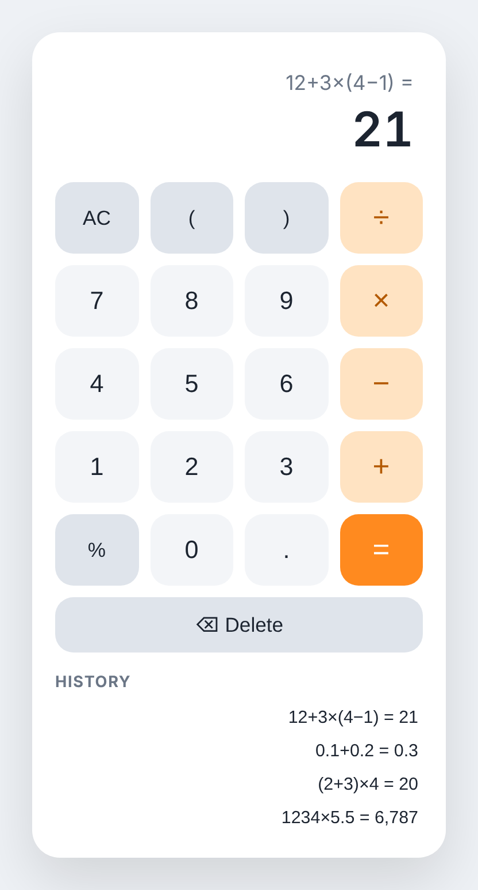

# Calculator

A clean calculator built with plain **HTML, CSS and JavaScript**: no frameworks and no `eval()`.



## Features

- Add, subtract, multiply, divide, brackets and percent (`200×10%` → `20`)
- Correct order of operations (`2+3×4` → `14`)
- Implied multiplication (`2(3+4)` → `14`)
- Very large and very small answers shown in scientific notation (`1.5e+21`), and you can keep calculating with them
- Live preview of the answer while you type
- Full keyboard support
- History of your last 10 calculations; click one to reuse the result
- Clear error messages (`Can't divide by zero`, `Mismatched brackets`, `Number too large`)
- Light and dark mode that follows your system setting
- Unit tests for the calculation engine

## How it works

The engine in [`calculator.js`](calculator.js) evaluates an expression in three steps:

1. **Tokenize**: split `12+3×(4−1)` into numbers, operators and brackets.
2. **Shunting-yard algorithm**: reorder the tokens into Reverse Polish Notation so operator precedence is respected: `12 3 4 1 − × +`.
3. **Stack evaluation**: read the RPN left to right, pushing numbers and applying operators.

Not using `eval()` keeps the calculator safe, and it means the math logic can be tested on its own.

[`app.js`](app.js) connects the buttons and keyboard to the engine, and [`style.css`](style.css) handles the layout and themes.

## Run it

Open `index.html` in any browser. There's nothing to install.

## Keyboard shortcuts

| Key | Action |
| --- | --- |
| `0`–`9`, `.` | Numbers |
| `+` `-` `*` `/` | Operators |
| `(` `)` `%` | Brackets and percent |
| `Enter` or `=` | Calculate |
| `Backspace` | Delete last character |
| `Esc` | Clear |

## Tests

Requires [Node.js](https://nodejs.org) 18 or newer:

```bash
node --test
```

## Project structure

```
calculator-web/
├── index.html           # Page layout and buttons
├── style.css            # Styling, light and dark themes
├── calculator.js        # Calculation engine (tokenizer, shunting-yard, evaluator)
├── app.js               # Button and keyboard handling, history
├── calculator.test.js   # Unit tests
└── screenshot.png       # Screenshot used in this README
```

## License

[MIT](LICENSE)
